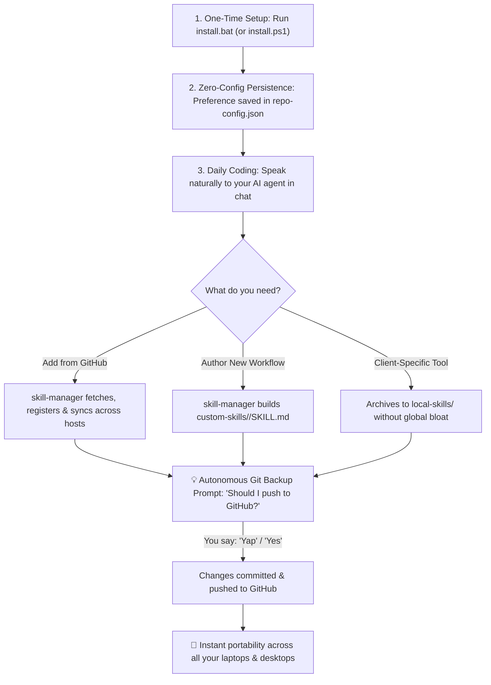

# 💡 Real-World Scenarios & Everyday Workflows

> A comprehensive walkthrough of how **Curated Skills** and **`skill-manager`** operate in everyday software development—from initial setup and daily chat-driven expansion to cross-machine synchronization and project-isolated archiving.

---

## 🧭 The Core Concept at a Glance

Traditional AI agent skills are often scattered across hidden folders, duplicated across multiple tools, or accidentally committed into client git repositories.

**Curated Skills** solves this by establishing a personal, version-controlled **"Dotfiles System"** for your AI agents:



---

## 🚀 Scenario 1: Fresh Machine / New Setup (The "Dotfiles" Experience)

### The Problem:
You bought a new laptop, set up a new workstation, or formatted your computer. You install **Google Antigravity**, **Claude Code**, and **Cursor**. Manually finding your favorite custom prompts, git workflows, and specialized skills would take hours.

### The Workflow:
1. Clone your personal curated skills repository:
   ```bash
   git clone https://github.com/<your-username>/curated-skills.git
   cd curated-skills
   ```
2. Double-click **`install.bat`** (Windows) or execute `./install.ps1` (macOS/Linux):
   * Pick **`[1] Auto-Detect and Sync ALL`** (Default).
   * Pick **`[1] Full Curated Pack`** (or `[2] Clean Slate` for an empty starter).
3. **The Result:** In less than 10 seconds:
   * All installed AI agents (`~/.gemini/config/skills`, `~/.claude/skills`, `~/.cursor/skills`) are populated with your exact, personalized skillset.
   * Your chosen preferences and repo path are saved to `repo-config.json`.
   * **You never need to double-click `install.bat` again on this machine!**

---

## 🎯 Scenario 2: Single-Host vs. Multi-Host Isolation

### The Question:
> *"What happens if I only choose Google Antigravity on the first day?"*

### The Workflow:
1. When running `install.bat`, you select:
   ```text
   [2] Google Antigravity only (%USERPROFILE%\.gemini\config\skills)
   ```
2. **What Happens Under the Hood:**
   * Skills are installed **only** into `.gemini/config/skills`.
   * Your Cursor, Claude Code, and Windsurf directories remain completely clean and untouched.
   * `repo-config.json` records `"targetHost": "gemini"`.
3. **Future Behavior:**
   * Whenever you ask your agent to add or create a skill in the future, it remembers your preference and installs **only to Antigravity**.
4. **Changing Your Mind Later:**
   * Months later, you start using Cursor or Claude Code and want your skills everywhere.
   * You don't need to reconfigure anything manually. Simply tell your AI agent:
     > *"Switch my sync target to auto and synchronize my skills."*
   * `skill-manager` updates your preference to `auto` and replicates your skills to all detected tools in milliseconds!

---

## 🌐 Scenario 3: Chat-Driven Skill Discovery (No Manual JSON Editing)

### The Situation:
While browsing Reddit, GitHub, or Twitter, you discover an awesome open-source skill (e.g., `https://github.com/someone/fastapi-pro-skill`).

### The Workflow:
1. Open your AI coding assistant (Antigravity, Cursor, or Claude Code).
2. Simply paste the link in chat:
   > *"Add this skill to my library: https://github.com/someone/fastapi-pro-skill"*
3. **Autonomous Scope Resolution:**
   `skill-manager` immediately detects the request and asks:
   > *"Would you like to install this skill **Globally** (available across all projects on this machine) or **Locally** (only in this specific project workspace)?"*
4. You reply: **"Globally"**.
5. **The Agent Automatically:**
   * Inspects the upstream repository and extracts `name`, `author`, `description`.
   * Adds an entry to `curated-skills/skills.json`.
   * Adds a row to `curated-skills/README.md`.
   * Runs the sync engine in the background to install it to your target AI hosts.
6. **Automatic Git Backup Prompt:**
   At the very end of its response, the agent asks:
   > 💡 **GitHub Sync:** Would you like me to commit and push these central repository changes to GitHub? Just reply with **"Yes"**, **"Do it"**, or **"Push"**.
7. You reply: **"Yap"** (or **"Yes"**).
8. The agent commits and pushes to GitHub. Now this skill is permanently part of your dotfiles!

---

## 🛠️ Scenario 4: Authoring Custom Bespoke Workflows

### The Situation:
You find yourself repeatedly asking your AI assistant to perform the same sequence of tasks (e.g., analyzing Kubernetes pod crashes and formatting a post-mortem report).

### The Workflow:
1. Tell your assistant:
   > *"Create a new custom skill called 'k8s-debugger' that inspects kubectl crash logs and outputs an incident summary table."*
2. **The Agent Automatically:**
   * Crafts a production-grade `SKILL.md` with action-oriented triggers and YAML frontmatter.
   * Saves it into `curated-skills/custom-skills/k8s-debugger/SKILL.md`.
   * Registers it into `skills.json` under `custom`.
   * Adds it to `README.md` under **Section 3: Custom Skills**.
   * Deploys it into your global AI environment so you can immediately use `/k8s-debugger`.
   * Prompts you to push to GitHub with a single confirmation word.

---

## 📦 Scenario 5: Client / Project-Specific Local Skills (Zero Project Bloat)

### The Problem:
You are working on a proprietary client project (e.g., an e-commerce platform with a bespoke Stripe webhook handler). You create a local skill specifically for this project.
* You do **NOT** want this client-specific skill installed globally on your machine (it's irrelevant for your other projects).
* You also do **NOT** want to lose this workflow when the project finishes.

### The Workflow:
1. Inside the project workspace, tell your assistant:
   > *"Bookmark / archive this project's local skill to my central curated repository."*
2. **The Agent Automatically:**
   * Copies the skill into `curated-skills/local-skills/stripe-helper/`.
   * Adds it to `curated-skills/skills.json` under `skills.local.custom`.
   * Adds a row to `curated-skills/README.md` under **Section 4: Cataloged Local Skills**.
   * **Crucial:** It does **NOT** install it into global directories. Global setup remains 100% clean.
3. **Restoring Months Later:**
   * Six months later, you start a new e-commerce project and need that workflow.
   * Simply ask your agent in the new workspace:
     > *"Restore the cataloged local skill 'stripe-helper' into this workspace."*
   * The agent copies it straight into `<current-workspace>/.agents/skills/stripe-helper/`.

---

## 🧼 Scenario 6: Clean Slate & Fresh Starts

### The Situation:
You want a minimalist setup with only the core autonomous brain (`skill-manager`), or a teammate wants to clone your repository to start their own private skills catalog from scratch.

### The Workflow:
1. Run `install.bat` and select `[2] Clean Slate (Empty Template)`.
2. A safety confirmation prompt appears:
   ```text
   [!] CONFIRMATION REQUIRED: Clean Slate Mode
   This will reset 'skills.json' and 'README.md' to clean templates (only skill-manager),
   prune 'custom-skills/' (except skill-manager) and 'local-skills/' (except .gitkeep) from this repo,
   and remove curated skills from your AI hosts (preserving any independent skills).
   ```
3. Type `y` and press Enter.
4. **Targeted Pruning Protection:**
   * All curated external and sample custom skills (`git-summary`, `push`) are uninstalled.
   * `skill-manager` remains active.
   * **Any independent skill** that you installed outside of this repository (e.g. `my-company-tool`) is **preserved and untouched**.
   * Your repository, documentation, and agent hosts are in 100% clean symmetry.

---

## 🔄 Scenario 7: Multi-Machine Portability (Home Desktop ⟷ Work Laptop)

### The Workflow:
1. **At Work (Machine A):**
   * You add a new skill during the day via chat.
   * The agent pushes to GitHub when you say *"Yes"*.
2. **At Home (Machine B):**
   * Pull the latest changes:
     ```bash
     cd curated-skills
     git pull
     ```
   * Tell your local AI agent:
     > *"Synchronize my skills with the central repository."*
   * Or double-click `install.bat`.
   * Instantly, all your home AI tools have the exact same skills you added at work earlier!

---

## 🗣️ Agent Dialogue Cheat Sheet

Once installed, you interact with `skill-manager` using natural language:

| What You Want to Do | What You Say to Your Agent | What the System Does |
| :--- | :--- | :--- |
| **Add external skill** | *"Add skill from `https://github.com/user/repo`"* | Resolves scope, downloads, registers in manifest & syncs hosts |
| **Create custom skill** | *"Create a custom skill for summarizing git diffs"* | Authors `SKILL.md`, registers in `custom-skills/`, syncs hosts |
| **Archive local skill** | *"Archive this project's local skill to central repo"* | Saves to `local-skills/` archive without global clutter |
| **Restore local skill** | *"Install cataloged local skill 'name' to this project"* | Restores archived skill into current workspace |
| **Remove a skill** | *"Remove the 'diagram-design' skill"* | Deletes folder, prunes from AI hosts, updates manifest |
| **Switch sync target** | *"Switch my sync target to auto"* | Updates `repo-config.json` and replicates across all AI tools |
| **Backup to GitHub** | *"Yap"* / *"Yes"* / *"Push"* | Runs `git add`, conventional commit, and `git push` |
